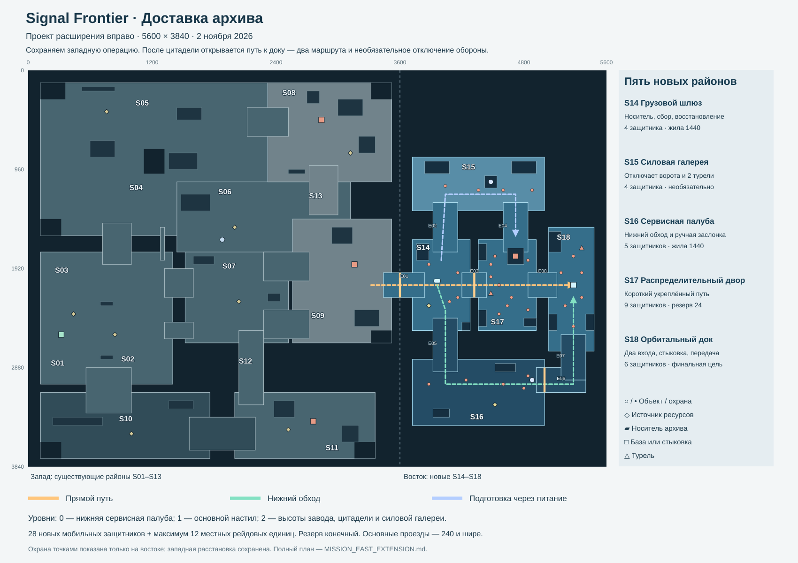

# Продолжение миссии Signal Frontier на восток

Дата: 2 ноября 2026 года. Основа: локальная версия 0.33.0, операция `frontier-9`, карта `districts`.

**Решение: расширить карту вправо и добавить завершающий этап «Доставка архива».** После падения цитадели игрок сохраняет базу, армию и экономику, открывает восточный грузовой шлюз, забирает транспортёр с архивом связи и доставляет его к орбитальному доку. Выбор — пробить короткий укреплённый маршрут, предварительно отключить его оборону или пройти через нижнюю сервисную палубу.

Ориентир продолжительности нового этапа — **8–12 активных минут** при первом осмысленном прохождении. Тактическая пауза в это время не входит. Подготовленный игрок может пройти быстрее; дополнительные районы дают до 12–16 минут без обязательной полной зачистки. Это исходные цели баланса, которые нужно проверить прохождениями, а не уже измеренная длительность.

Этот документ и сопровождающая схема — проект для последующей разработки. Изменений в игру в рамках подготовки плана нет. Все новые координаты, характеристики и интервалы ниже задают первую согласованную версию прототипа; при изменении одного параметра нужно проверять связанные маршруты и баланс.

## 1. Зачем миссии нужен такой финал

Сейчас победа наступает сразу после уничтожения цитадели. К этому моменту игрок уже построил инфраструктуру, организовал добычу, набрал армию и научился использовать высоты. Небольшое продолжение позволит применить эту подготовку к другой задаче: сохранить ценный подвижный объект и подготовить ему путь.

Цитадель остаётся главным военным рубежом первой части. В ней находится архив маршрутов и командных протоколов. Тактический ретранслятор обеспечивает местную связь, но отправить архив за пределы станции можно только через орбитальный док. Архив хранится в защищённом носителе транспортёра; игроку не требуется вручную таскать предмет героем.

Общую цель нужно сообщать **с начала новой версии миссии**: «Разгромить командный узел и вывести архив через восточный док». После цитадели — сообщение о выполнении первого этапа и открытии шлюза, без экрана победы. Так продолжение воспринимается как завершение известной задачи.

Новый этап не требует нового уровня технологий, повышения лимита населения или обязательного строительства второй базы. Бункеры, экстракторы с лечением, зонды, артиллерия и команды следования получают дополнительные полезные применения в существующих правилах.

## 2. Что уже существует и что добавляется

Подтверждённое состояние текущего начала операции:

| Параметр | Текущая игра |
| --- | --- |
| Карта | 3600 × 3840 мировых единиц |
| Поверхность | Шаг сетки 40; уровни 0, 1, 2; разница уровней 72 |
| Районы | 13 смысловых районов на связанных платформах |
| Игрок | Разведчик, база, 3 бойца, 2 зонда, 180 сплава |
| Добыча | 8 источников: 1440 у базы и 7 × 2160; всего 16 560 сплава без контейнеров |
| Начальная мобильная армия противника | 78 единиц |
| Стационарный противник | 8 турелей, 2 бастиона, цитадель и подавитель |
| Запасы подкреплений трёх баз | 60, 60 и 72 единицы; суммарно 192 |
| Наступающие подкрепления | Действуют ограничения на 32 мобильные рейдовые единицы и 2 наступающие группы |
| Логистика игрока | До 120 населения и до 48 зондов; реальные пределы зависят от узлов снабжения |
| Завершение | Гибель героя или базы — поражение; уничтожение цитадели — победа |

В старом `MAP_DESIGN.md` приведены более ранние проектные количества, включая 48 начальных врагов. Для этого продолжения исходной точкой служит фактическая расстановка нынешнего кода: 78 мобильных врагов.

Добавляется: 5 районов, один транспортёр, один небольшой источник вражеских подкреплений, 28 заранее размещённых мобильных защитников, 2 турели, 2 месторождения и 2 контейнера. Текущие западные районы не растягиваются и не получают дополнительные гарнизоны.

## 3. Полная карта после расширения

Новые размеры — **5600 × 3840**. Север сверху; X растёт вправо, Y вниз. Исходная область занимает X = 0–3600, новая — X = 3600–5600. Координаты относятся к поверхности, а не к экранной проекции. Новая сетка — 140 × 96 клеток.

Схема показывает платформы, соединения, основные объекты и предлагаемые пути. Это план размещения, не готовая навигационная сетка. Габариты проездов, следы построек, укрытия и зоны поворота проверяются при создании прототипа.

### Западная часть

| Район | Границы X, Y, ширина, высота | Уровень | Назначение в полной миссии |
| --- | --- | ---: | --- |
| S01 Площадка высадки | 120, 2080, 600, 960 | 1 | Домашняя база и начальная добыча; остаётся тылом до победы |
| S02 Западная экспансия | 720, 2200, 680, 840 | 1 | Первая внешняя экономика, обучение защите зондов |
| S03 Западные мосты | 120, 1440, 1280, 760 | 1 | Выход к промышленной зоне, главный и пехотный пути |
| S04 Промышленные склады | 120, 640, 2200, 840 | 1 | Манёвренные бои, укрытия, доступ к северу и связи |
| S05 Северная добыча | 120, 120, 2200, 520 | 1 | Ресурсы и подготовка наступления на северный завод |
| S06 Ретранслятор | 1440, 1080, 1120, 680 | 1 | Подавитель у (2320, 1280), связь у (1880, 1640) |
| S07 Перекрёсток | 1520, 1760, 1040, 880 | 1 | Передовой сбор армии, добыча у (2040, 2240), развилка |
| S08 Северный завод | 2320, 120, 1200, 960 | 2 | Существующий бастион у (2840, 480), тяжёлая оборона и добыча |
| S09 Командная цитадель | 2560, 1440, 960, 1200 | 2 | Первый главный рубеж; после захвата — проход в восточную часть |
| S10 Карьер | 120, 3120, 1640, 640 | 0 | Нижняя экспансия и альтернативный подход к арсеналу |
| S11 Южный арсенал | 2000, 3120, 1360, 640 | 1 | Существующий бастион у (2760, 3400), южная экономика |
| S12 Южный коридор | 2000, 2640, 280, 480 | 1 | Связь арсенала и перекрёстка |
| S13 Восточный обход | 2560, 1080, 480, 360 | 1 | Старый обход цитадели; не является входом в новую половину |

Границы районов служат для наполнения и ориентации. Реальная поверхность по-прежнему задаётся платформами и связями из `terrain.js`; прямоугольник района сам по себе не разрешает ходить по разлому.

Существующие соединения сохраняются:

| Связь | Границы X, Y, ширина, высота | Уровни |
| --- | --- | --- |
| Западный мост | 720, 1480, 280, 400 | 1 → 1 |
| Пехотный мост | 1280, 1520, 40, 320 | 1 → 1 |
| Мост перекрёстка | 1320, 1920, 280, 280 | 1 → 1 |
| Нижний мост перекрёстка | 1320, 2440, 280, 160 | 1 → 1 |
| Северная рампа | 2120, 360, 400, 280 | X: 1 → 2 |
| Рампа от северной высоты | 2720, 920, 280, 480 | Y: 2 → 1 |
| Главная рампа цитадели | 2280, 1760, 440, 280 | X: 1 → 2 |
| Южная рампа цитадели | 2280, 2320, 440, 280 | X: 1 → 2 |
| Мост арсенала | 2040, 2520, 240, 720 | 1 → 1 |
| Карьерная рампа | 560, 2880, 440, 440 | Y: 1 → 0 |
| Рампа арсенала | 1560, 3360, 640, 320 | X: 0 → 1 |

### Восточная часть

| Район | Границы X, Y, ширина, высота | Уровень | Главная функция |
| --- | --- | ---: | --- |
| S14 Грузовой шлюз | 3720, 1640, 560, 880 | 1 | Получение транспортёра, сбор и восстановление армии |
| S15 Силовая галерея | 3720, 840, 1280, 520 | 2 | Необязательное отключение ворот и двух турелей |
| S16 Сервисная палуба | 3720, 2800, 1280, 640 | 0 | Обход основной обороны, дополнительная добыча |
| S17 Восточный распределительный двор | 4360, 1640, 560, 880 | 1 | Короткий укреплённый путь и источник местных подкреплений |
| S18 Орбитальный док | 5040, 1520, 440, 1200 | 1 | Конечная цель, стыковка носителя и отправка архива |

Между платформами — технические шахты и разрывы настила. Верхняя и нижняя части добавленного прямоугольника не заполняются лишними островами: там видны крупные закрытые конструкции станции, не обещающие прохода. Последние 120 единиц до правой границы оставлены под внешний край дока. В новой части сохраняются три прежние высоты.

### Новые соединения

| ID | Границы X, Y, ширина, высота | Связь и состояние |
| --- | --- | --- |
| E01 | 3440, 1960, 400, 240 | Спуск X: 2 → 1 из цитадели в S14; входной шлюз закрыт до падения цитадели |
| E02 | 3920, 1280, 240, 480 | Подъём из S14 в S15; по возрастанию Y высота 2 → 1 |
| E03 | 4200, 1960, 240, 240 | Прямой проезд S14 → S17, уровень 1; местные силовые ворота |
| E04 | 4600, 1280, 240, 480 | Северный подход S15 → S17, Y: 2 → 1 |
| E05 | 3920, 2400, 240, 520 | Спуск S14 → S16, Y: 1 → 0 |
| E06 | 4920, 2880, 480, 240 | Нижний переход от S16 к рампе дока, уровень 0; ручная сервисная заслонка |
| E07 | 5160, 2560, 240, 440 | Подъём с нижнего перехода в S18; по возрастанию Y высота 1 → 0 |
| E08 | 4840, 1960, 280, 240 | Выход S17 → S18, уровень 1 |

Перекрытия концов связей с платформами намеренные: они убирают щели навигации. Рампа имеет приоритет над плоской связью и платформой и задаёт единственную поверхность на всём своём прямоугольнике; второго проходимого этажа под ней нет. Это особенно важно для пересечения E06/E07: иначе плоский переход обрежет нижнюю часть подъёма и создаст ступень. Нижний маршрут подходит к E07 через (5280, 3040), затем поворачивает на север к доку. Декор не уменьшает чистую ширину основных новых проездов ниже 200. На концах рамп нужны открытые зоны разворота не менее 160 × 160.

Прямой путь: **S09 → S14 → S17 → S18**. Обход: **S09 → S14 → S16 → S18**. Силовая галерея связывает S14 и северный край S17, позволяя подготовить короткий путь.

## 4. Подробное наполнение новых районов

### S14 Грузовой шлюз

Игрок спускается с высоты цитадели и видит закрытый транспортный бокс, широкую площадку и два направления дальнейшего движения. Транспортёр стоит в боксе у **(3960, 2040)**. Он существовал здесь до открытия шлюза, поэтому не появляется внезапно под камерой. Короткое взаимодействие героя загружает подготовленный архив и разрешает управление.

Гарнизон — 3 охранника `sentinel` и 1 страж `warden`. Два охранника держат восточный выход, третий — подход к северной рампе. Страж стоит у распределительной стойки южнее бокса. Никто не появляется за спиной после активации транспорта. После зачистки этот район становится безопасным местом сбора, если игрок сам не пропустил сюда колонну.

Источник сплава — **(3880, 2280)**, запас 1440. Карман под экстрактор — около **(4160, 2320)**; окончательное место подчиняется общему запрету ставить экстрактор вплотную к ресурсу. Свободный квадрат 160 × 160 под компактное здание — около **(4160, 1840)**, между северной рампой и прямым проездом. Более крупные производства остаются на просторных западных площадках. Транспорт не паркуется на пути зондов. При окончательной раскладке площадка, ресурс, полоса движения и след 4 × 4 клетки проверяются одновременно.

Контейнер на 120 сплава находится у **(3800, 2440)**. Он даёт небольшую страховку после тяжёлого штурма цитадели. Обязательная операция с носителем бесплатна и не зависит от строительства здесь.

Декор: утопленные грузовые направляющие, закрытая боковая кабина, две небольшие стойки обслуживания. Основной цвет — серый металл, голубой акцент ведёт от бокса к выходам. Грузовой маршрут шириной около 200 остаётся свободным.

### S15 Силовая галерея

Высокая узкая платформа, видимая с нижнего подхода по светлой кромке и силовым кожухам. В центре, у **(4480, 1080)**, находится распределитель местного питания. Два крупных декоративных блока размещены по краям, приблизительно у (3920, 960) и (4760, 960), вне прохода между рампами. Между ними остаётся манёвр для пехоты и тяжёлой техники.

Охрана: 2 охранника, 1 страж и 1 ракетчик. Ракетчик стоит глубже площадки, а не непосредственно над входной рампой. Дальний огонь не проходит сквозь край высоты. Враг может отходить за силовой блок, но не проваливается в непроходимый декор.

Распределитель можно отключить взаимодействием героя в течение **3 секунд** после вытеснения охраны из радиуса 140 либо уничтожить. Исходный запас прочности — 600. Оба способа навсегда открывают ворота E03 и отключают турели S17 и S18. Завод продолжает выпуск мобильной охраны до собственного уничтожения или исчерпания резерва.

Результат сразу виден: погасли голубые кабельные вставки, выключились орудийные датчики, на мини-карте снят значок закрытых ворот. Точные позиции ещё не обнаруженных врагов не раскрываются. Посещение галереи необязательно для победы; её награда — изменение боя, без нового обязательного ресурса.

### S16 Сервисная палуба

Нижняя, более широкая площадка позволяет обойти восточный распределительный двор. Вход с севера через E05, выход в док — через E06 и E07. В центре не должно быть лабиринта: один широкий проход идёт вдоль Y ≈ 3040, один короткий карман у добычи позволяет развернуть войска и остановить транспорт.

Гарнизон: 2 охранника, 2 бегуна и 1 огнемётчик. Охранники держат начало перехода, бегуны патрулируют центральную площадку, огнемётчик прикрывает сервисную заслонку. Их зоны тревоги пересекаются постепенно, чтобы один шаг разведчика не поднимал всю восточную половину.

Источник сплава — **(4520, 3240)**, запас 1440. Карман экстрактора — около **(4200, 3240)**; зонды не пересекают центр колонны. Контейнер на 180 сплава — **(4800, 3320)**. Добыча здесь выгодна при восстановлении потерь, но для быстрого прохождения не нужна.

Пульт заслонки — **(4880, 3000)**, створка — на переходе около X = 5000. Герой открывает её за **6 секунд** без модуля проникновения и без затрат. Требуются свободный подход и отсутствие противника в радиусе 140. Открытая заслонка больше не закрывается; прерванное взаимодействие сохраняет уже выполненную часть работы.

Обход длиннее прямого, но движение само по себе занимает десятки секунд, а не несколько минут. Его цена — бой в низине, необходимость проверить выход к доку и более длинный путь ремонта. Он не включает обязательную охоту за ключом на другом конце карты.

Декор: редкие низкие трубы вдоль наружного края, плоские ремонтные вставки, матовые потёртости. Все отверстия действительно непроходимы; нарисованные тёмные пятна на проходе не имитируют ямы.

### S17 Восточный распределительный двор

Это компактная действующая база охраны, а не четвёртая цитадель. Её функция — перекрывать короткий путь и посылать ограниченные местные подкрепления. Производственный узел стоит у **(4720, 1800)**, сбор — около **(4600, 1920)**, свободный выход — к югу от узла. Исходные параметры: след 160 × 160, 1000 HP; визуальная основа — существующий вражеский бастион с другой компоновкой верхнего оборудования.

Гарнизон — 9 единиц: 3 охранника, 2 стража, 1 ракетчик, 2 танка и 1 миномёт. Ориентиры размещения:

| Группа | Место и задача |
| --- | --- |
| 2 охранника и страж | Западный вход, примерно (4440, 2040); не стоят в самой створке |
| Танк и охранник | Южная половина, около (4600, 2320); контратака к открытому въезду |
| Второй танк и страж | Северная половина, около (4520, 1800); охрана производственного выхода без пересечения корпуса здания |
| Ракетчик | Восточный край, около (4840, 2320), за низким укрытием |
| Миномёт | Задний карман около (4840, 1840); не стреляет по скрытым целям без обнаружения |

Это центры групп, не одинаковые координаты всех их бойцов. При постановке выдерживаются радиусы корпусов, свободные пути и дистанция до здания. Турель стоит у **(4480, 2160)**. Два низких укрытия ориентированы вдоль направления движения и не образуют сплошную стену поперёк двора.

Ворота E03 можно открыть отключением питания в S15 либо разрушить: **450 HP**, одна короткая анимация открытия/разрушения, после которой навигация и прострел действительно освобождаются. Уничтожение самого производственного узла тоже открывает эти ворота как аварийный выход. Носитель может пройти после зачистки проезда; полное уничтожение всех объектов района для победы не требуется.

### S18 Орбитальный док

Длинная платформа имеет два входа: западный E08 и южный E07. Место стыковки — **(5280, 2080)**, пульт отправки — **(5360, 2040)**. Верхний и нижний концы платформы заняты закрытой портовой инфраструктурой. За восточным краем — фоновая конструкция орбитального комплекса; она не создаёт дополнительный проход или ещё одну будущую обязательную цель.

Гарнизон — 3 охранника, 1 страж, 1 ракетчик и 1 танк. Танк занимает южный подход, охранники распределены по западному входу и площадке стыковки, страж охраняет пульт, ракетчик стоит в северном кармане. Турель — **(5360, 1720)**. Расстановка не должна позволять всем семи противникам одновременно стрелять в носитель сразу при выходе из одной рампы.

Завершение: носитель остановлен в радиусе 56 от стыковочной точки, имеет HP выше нуля; герой активирует пульт за 3 секунды. Затем идёт **12 секунд передачи**, пока в радиусе 220 от стыковки нет живых боевых врагов. При вторжении или обездвиживании носителя передача приостанавливается, но не откатывается. Достаточно освободить площадку и продолжить. Тактическая пауза останавливает все эти таймеры.

После передачи — полноценная победа: защёлки закрылись, сигнал ушёл, показан итог операции с обеими частями. Новый бесконечный штурм или третья цель после этого не запускаются. Если игрок заранее зачистил подходы и остановил завод, финал может пройти спокойно — это заслуженный результат подготовки.

### Расстановка для первого прототипа

Следующая таблица уточняет групповые ориентиры выше. Все позиции — центры объектов. Короткие патрули отклоняются от них внутри своего района, не пересекают закрытые створки и не создают дополнительную охрану.

| Район | Тип | Начальные позиции X, Y |
| --- | --- | --- |
| S14 | Охранник × 3 | (4160, 1960); (4160, 2200); (3880, 1880) |
| S14 | Страж × 1 | (4080, 2240) |
| S15 | Охранник × 2 | (4040, 1120); (4600, 1160) |
| S15 | Страж × 1 | (4360, 1160) |
| S15 | Ракетчик × 1 | (4880, 1160) |
| S16 | Охранник × 2 | (3880, 3040); (4800, 3080) |
| S16 | Бегун × 2 | (4240, 3000); (4600, 3040) |
| S16 | Огнемётчик × 1 | (4840, 2960) |
| S17 | Охранник × 3 | (4480, 2000); (4560, 2080); (4640, 2280) |
| S17 | Страж × 2 | (4480, 1880); (4680, 2200) |
| S17 | Танк × 2 | (4520, 1800); (4560, 2360) |
| S17 | Ракетчик × 1 | (4840, 2320) |
| S17 | Миномёт × 1 | (4840, 1840) |
| S18 | Охранник × 3 | (5160, 1960); (5200, 2280); (5360, 2200) |
| S18 | Страж × 1 | (5360, 1960) |
| S18 | Ракетчик × 1 | (5280, 1800) |
| S18 | Танк × 1 | (5280, 2480) |

Крупный декор, который действительно блокирует движение и прямые выстрелы:

| ID | Границы X, Y, ширина, высота | Объект |
| --- | --- | --- |
| D01 | 3760, 1680, 120, 160 | Закрытая кабина шлюза |
| D02 | 4200, 2440, 80, 80 | Груз у южного внешнего края |
| D03 | 3840, 880, 240, 120 | Западный силовой кожух |
| D04 | 4680, 880, 240, 120 | Восточный силовой кожух |
| D05 | 3920, 3280, 160, 80 | Нижняя сервисная стойка |
| D06 | 4520, 2840, 200, 80 | Короб обслуживания у северного края низины |
| D07 | 4360, 1680, 80, 160 | Верхнее укрытие западного края S17 |
| D08 | 4360, 2320, 80, 160 | Нижнее укрытие западного края S17 |
| D09 | 4800, 2400, 120, 80 | Заднее укрытие распределительного двора |
| D10 | 5040, 1560, 120, 200 | Северная закрытая кабина дока |
| D11 | 5040, 2360, 80, 160 | Южная стойка дока, вне рампы |
| D12 | 5400, 2360, 80, 160 | Закрытый восточный грузовой карман |

Высота препятствий должна использовать обычные правила укрытия игры, а не невидимую стену до неба. Носитель и тяжёлые юниты обходят их по общей навигации. Проверка живым составом обязательна: большие дальности стрельбы могут связывать соседние районы в один бой. Нельзя компенсировать плохое размещение искусственной остановкой стрельбы на границе сектора.

## 5. Транспортёр и управление им

Рабочее имя — **«Носитель архива»**. Это единственная новая подвижная модель продолжения: низкая четырёхколёсная или двухгусеничная машина с герметичной центральной капсулой, широким устойчивым корпусом и сдержанным голубым индикатором. Окончательно выбрать двухгусеничное шасси: оно согласуется с существующей техникой и рампами.

| Параметр | Исходное значение |
| --- | --- |
| HP | 900 |
| Скорость | 70 мировых единиц/с; чуть медленнее артиллерии |
| Радиус движения | 24; те же требования к пути, что у тяжёлого танка |
| Оружие | Нет |
| Обзор | 240, без раскрытия сквозь высоты |
| Население | 0; нельзя покупать копии, продавать, разбирать или отправлять в экстрактор/бункер |
| Получение | Взаимодействие героя с боксом в S14 в течение 3 секунд после открытия входа |
| Команды | Двигаться, остановиться, следовать, направиться к доку |

После получения носитель **ждёт приказа**. Он не начинает ехать в неизвестную оборону. Его можно выделить, включить в группу, поставить обычные точки маршрута и отвести назад. ПКМ по носителю при выбранных войсках даёт им уже знакомый приказ следования. При смешанном выделении команда движения работает для каждого участника с учётом его габаритов.

Кнопка «К доку» выбирает доступный маршрут по реальной проходимости и показывает его на мини-карте. Она не отправляет машину через закрытые ворота. Если возможны обе дороги, перед запуском виден выбранный путь; игрок может задать другой обычными приказами. Следующие за транспортом войска не обязаны стоять в искусственном круге, чтобы он двигался.

Враги атакуют носитель после настоящего обнаружения. Его положение не рассылается всем базам сквозь туман. Боевые войска сопровождения остаются угрозой: противник не должен всей армией пробегать через них только ради груза.

### Повреждение и восстановление

При нуле HP носитель обездвиживается и переходит в отдельное состояние «Нужен ремонт». Архив не исчезает, миссия не становится непроходимой. Корпус остаётся на месте; это не обычный удаляемый труп. Его можно восстановить зондами: стартовый темп 6 HP/с на зонд, максимум 12 HP/с суммарно. Для движения после обездвиживания нужны 360 HP. В обычном повреждённом состоянии остановка движения не требуется.

Если зонды потеряны и денег на них нет, герой может выполнить аварийный ремонт: 20 секунд суммарной работы до восстановления 360 HP. Нужны дистанция до 80, отсутствие врага в радиусе 140 и отсутствие полученного героем урона последние 3 секунды. Работа прерывается при опасности без потери накопленного прогресса. Этот бесплатный ремонт относится только к уникальному носителю; он не заменяет экономику лечения остальных войск.

Транспорт не телепортируется при заторе, восстановлении или загрузке сохранения. Если дорога занята союзниками, они освобождают коридор. Если её перекрыла стройка, игрок видит причину и может изменить приказ. Обязательную стыковочную площадку, створки и узкие соединения нельзя застроить; свободные карманы рядом доступны под бункеры и экстракторы.

## 6. Враг и предел давления

Начальная восточная охрана распределена заранее: **4 + 4 + 5 + 9 + 6 = 28 мобильных единиц**. Плюс 2 турели и производственный узел. Защитники не возрождаются на местах. Потеря района оставляет его очищенным, пока туда физически не пришла новая группа.

Единственный новый производственный источник находится в S17. Его конечный резерв — **24 единицы**, четыре группы по шесть:

| Группа | Состав |
| --- | --- |
| A | 2 охранника, 2 бегуна, 1 ракетчик, 1 страж |
| B | 2 охранника, 1 страж, 1 ракетчик, 1 огнемётчик, 1 танк |
| C | 1 охранник, 2 стража, 1 ракетчик, 1 танк, 1 миномёт |
| D | 2 охранника, 1 страж, 1 ракетчик, 1 бегун, 1 танк |

Первая подготовка начинается не раньше чем через 75 секунд после открытия восточного шлюза. На сбор группы отводится 30 секунд, поэтому первый выход — не раньше 105-й секунды. Между выходами — минимум 90 секунд. Если группа ещё не имеет допустимой обнаруженной цели, она держит район или проверяет последний известный вход; скрытая позиция носителя ей неизвестна.

Одновременно допускается не больше **12 новых рейдовых единиц** и двух восточных походных групп. Общие ограничения всех рейдов — не больше 32 единиц и двух наступающих групп — также действуют. Выход новой группы ждёт свободного места целиком. Нельзя обойти предел, выпустив несколько групп в один такт.

Следовательно, восточная часть даёт не более **40 живых мобильных врагов**: 28 первоначальных и 12 рейдовых. Израсходованный резерв не возвращается после гибели бойцов. Затруднённый выход удерживает завершённую очередь у источника; он не создаёт бойцов внутри чужих корпусов и не дублирует их после перезагрузки. Разрушение завода прекращает новые выходы, уже выпущенные бойцы остаются.

### Что происходит со старыми базами

После падения командной цитадели северный и южный бастионы прекращают **новые** заказы и отправки: потерян общий командный канал. Этот результат прямо назван в сообщении о взятии цитадели. Неизрасходованные резервы не превращаются в бесплатную последнюю волну и не обнуляются скрытым удалением армии.

Уже вышедшие колонны продолжают последнее задание; территориальная охрана защищает свои районы. Уничтоженные враги не возвращаются. Перед выездом на восток игрок получает естественную возможность проверить тыл и оставить небольшой гарнизон, но не обязан зачищать все старые базы.

До открытия восточного шлюза S17 не производит войска и не копит очереди. Восточные гарнизоны находятся в спокойном состоянии, пока нет контакта. Законная разведка с западной высоты и ранний артиллерийский обстрел разрешены: замеченный или атакованный противник немедленно реагирует по обычным правилам, даже если входной шлюз ещё закрыт. Ранние потери гарнизона и разрушение завода сохраняются после открытия востока. Нельзя делать видимого врага неподвижной неуязвимой декорацией до сюжетного триггера; при активации никто не появляется в уже видимой пустой точке.

## 7. Экономика и варианты прохождения

Новые источники содержат 2880 сплава; контейнеры добавляют ещё 300. Это примерно 17% прежнего запаса в жилах, достаточная страховка для восстановления, а не новая обязательная экономическая эпоха. Всего жил на расширенной карте — 10, их суммарный запас — 19 440 сплава, без контейнеров.

Активация носителя, открытие сервисной заслонки и отправка архива бесплатны. Миссия должна оставаться достижимой при исчерпанной западной добыче. Новые ресурсы стоят в доступных районах S14/S16, до обязательного штурма дока.

| Подход | Порядок | Выигрыш и цена |
| --- | --- | --- |
| Прямой штурм | S14 → разрушить E03 → S17 → S18 | Короткая дорога; сильный бой против танков, турели и миномёта |
| Подготовленный штурм | S14 → S15 → S17 → S18 | Один дополнительный небольшой бой, открытые ворота и выключенные турели |
| Нижний обход | S14 → S16 → открыть заслонку → S18 | Можно оставить завод живым; нужно прикрывать длинный маршрут и южный выход |

Смешивать подходы разрешено: сначала отключить питание, затем провести груз снизу, а артиллерией сдерживать завод. Нельзя необратимо закрывать один маршрут выбором другого.

Ориентир состава на входе: герой, 10–16 бойцов, 1–3 артиллерийские машины и 2–4 зонда. Это контрольный сценарий баланса, не условие допуска. Отдельно проверяется путь пехотой без артиллерии и прохождение после заметных потерь первой части. Дополнительный лимит населения ради продолжения не вводится.

## 8. Последовательность событий

| Состояние | Условие входа | Что происходит | Следующий шаг |
| --- | --- | --- | --- |
| Западная операция | Новая игра | Прежнее развитие, осада или проникновение; восточный шлюз закрыт | Уничтожить цитадель |
| Восток открыт | Цитадель уничтожена | Фиксируется выбранная ветка первой части; новые заказы старых баз прекращаются; шлюз открывается | Зачистить S14 и получить носитель |
| Архив получен | Завершено взаимодействие с боксом | Носитель доступен для приказов; видны задача и путь к доку | Выбрать и подготовить маршрут |
| Доставка | Есть приказ носителю | Движение, бой, ремонт; необязательные цели доступны в любом порядке | Достичь стыковки |
| Передача | Носитель у дока, герой активировал пульт | 12 секунд чистого времени передачи; при помехах — пауза | Завершить передачу |
| Победа | Передача завершена, герой и домашняя база живы | Остановить симуляцию, показать итог и сохранить результат | Конец миссии |

Обездвиживание носителя — вложенное состояние доставки или передачи, а не отдельная новая глава. Получение награды, открытие створок и отправка архива срабатывают только один раз. Если герой или база уничтожены одновременно с последним тактом передачи, приоритет остаётся за прежним условием поражения.

После цитадели нужно сохранить результат «осада/проникновение» отдельно. Нельзя определять его в конце второй части по уже истёкшему таймеру терминала первой части.

Переход ко второму этапу не включает принудительную паузу и не перетаскивает камеру. Появляется короткое уведомление с необязательной кнопкой «Показать шлюз». Створки открываются примерно за 1,2 секунды; проезд становится доступным после фактического освобождения проёма. При загрузке во время открытия сохраняется согласованное состояние анимации и препятствия.

## 9. Темп и пример прохождения

Ориентировочные 8–12 минут складываются из решений и боёв, а не из замедления транспорта:

1. **0–2 минуты нового этапа:** освободить шлюз, осмотреть новый выход, получить носитель, собрать уцелевшую армию. При необходимости — лечение и первая добыча в S14.
2. **2–5 минут:** выбрать путь; подготовленный штурм идёт в галерею, обход — на нижнюю палубу. К этому моменту может появиться первая местная колонна, если завод не подавлен.
3. **5–8 минут:** зачистить выбранный проход, отремонтировать повреждённые машины, провести носитель. Для сопровождения достаточно уже созданной группы; нижняя панель не заставляет искать особое меню миссии.
4. **8–12 минут:** освободить док, отбить оставшуюся подошедшую группу, выполнить передачу и увидеть завершение.

Если игрок подготовил маршрут заранее, транспорт проходит его быстро. Для такого прохождения допустимы 4–7 минут дополнительного этапа. При неудаче игрок отступает, чинит носитель и меняет маршрут, а не повторяет всю первую часть.

Три автосохранения: после падения цитадели, после получения носителя и после открытия сервисной заслонки/отключения распределителя. Ручное сохранение работает в любой обычной точке, включая ремонт и передачу. Тактическая пауза не ограничивается.

## 10. Визуальное оформление и интерфейс

Восток выглядит как продолжение промышленной станции: серый матовый настил, графитовые несущие части, голубые технические вставки. Высокая галерея светлее, распределительный двор грубее и темнее, сервисная палуба более изношена, док чище. Враги сохраняют свои янтарные сигналы, чтобы не смешиваться с голубой средой.

Светлая верхняя кромка и тёмный борт показывают уступы. Пандусы отмечены редкими направленными вверх шевронами. На обычном полу нет постоянной квадратной сетки. Световые линии не должны напоминать маршруты выбранной армии или новые ресурсы.

Новые обязательные изображения и модели:

| Объект | Представления |
| --- | --- |
| Носитель архива | Ожидание в боксе, движение, остановка, лёгкие/тяжёлые повреждения, обездвиживание, ремонт, стыковка; одна 3D-модель с анимациями |
| Грузовые ворота | Закрыто, открытие, открыто; у E03 дополнительно разрушено |
| Силовой распределитель | Работает, отключается, отключён, повреждён; можно собрать из существующих технических форм |
| Док | Свободен, носитель установлен, передача, передача приостановлена, завершение |
| Производственный узел S17 | Вариант существующего вражеского бастиона с читаемым выходом |

У носителя движутся гусеницы, индикатор показывает состояние архива; ремонт использует существующие эффекты зондов. Не нужны отдельные нарисованные кадры для каждого направления. Ориентир игровой геометрии носителя — 6000–10000 треугольников, 1–2 материала, текстуры до 1024 px; это проектный бюджет для одной редкой машины, проверяемый в сцене.

В списке задач одновременно видны основная цель и не более двух полезных подцелей. Пример: «Доставьте носитель в док», ниже — «Можно отключить питание обороны» и «Нижний путь закрыт сервисной заслонкой». Старые выполненные цели сворачиваются в историю.

На мини-карте носитель обозначен голубым ромбом с маленькой центральной точкой; повреждённый — тем же ромбом с ремонтным ключом. Док — контуром причала. Закрытые обнаруженные ворота имеют поперечную черту, отключённое питание — погасший значок. Условные обозначения не совпадают с кружками врагов и жил.

Мини-карта вписывает новый прямоугольник целиком с сохранением пропорций. След камеры остаётся проекцией действительной области обзора. До открытия востока гарнизоны, ресурсы и устройство неизвестных районов не раскрываются автоматически; обычная ранняя разведка с западных высот разрешена. После открытия можно показать приблизительное направление дока как сведения задания, отличая его от разведанных объектов.

## 11. Производительность как условие разработки

Увеличение ширины мира на 55,6% не должно означать такое же увеличение работы каждого кадра. Особенно важны исследование новых территорий, переключение камеры между тылом и доком и встреча нескольких отрядов.

1. **Геометрия по участкам.** Западные поверхности остаются на прежних координатах. Статический восток строится один раз; дальние участки не участвуют в отрисовке. Рампы, перила и кромки объединяются с поверхностью участка, а не становятся сотнями отдельных объектов.
2. **Постоянная плотность текстур.** Не растягивать прежнюю карту 2048 px на новый мир. Исходный ориентир — около 0,53 пикселя на мировую единицу. Участок 1920 × 1920 с текстурой 1024 × 1024 сохраняет эту плотность. Для всей карты достаточно сетки из 3 × 2 участков, но загружать и удерживать высокую детализацию следует по необходимости, с предварительной загрузкой соседнего участка.
3. **Туман по изменяемым участкам.** Не возвращаться к чтению и загрузке полной маски мира при открытии нескольких клеток. Для большого мира нужен ограниченный набор участков тумана с той же плотностью и согласованными краями; сглаживание не ухудшается. Время и объём обновлений измеряются отдельно от FPS.
4. **Подготовка входа.** Пока игрок штурмует цитадель, ближайшие материалы S14 можно подготовить в фоне. Открытие шлюза не запускает синхронную загрузку всей новой половины. Поздняя загрузка рисунка не останавливает управление.
5. **Ограниченный противник.** Конечный резерв и предел 40 восточных мобильных врагов обязательны. До открытия шлюза нет скрытого накопления производства. Гарнизоны, стоящие без дела, не пересчитывают путь каждый кадр; контакт, урон или приближение игрока выводят их из спокойного состояния независимо от сюжетной фазы. После активации движение и стрельба идут непрерывно.
6. **Пути и команды.** Индексы препятствий общие для отрядов. Открытие конкретной створки инвалидирует связанные пути, а не заставляет всю армию одновременно строить новые маршруты. Обходы затора распределяются по тактам; положение курсора не ждёт этих вычислений.
7. **Обе версии изображения.** Babylon и Canvas получают одинаковые высоты, двери и события. Рисунки пола и памяти в Canvas тоже разбиваются на ограниченные участки; нельзя создавать огромный промежуточный холст только ради полной карты.

Контрольные сцены: исходная западная база; спокойный шлюз; движение камеры через новую границу; полный лимит 120 населения, включая 48 зондов, при восточном бое; одновременные две колонны; первый вход в ещё не разведанный док. Сравнение выполняется на одинаковом устройстве, разрешении, числе войск и масштабе камеры. Цель — не более 10% ухудшения p95 времени кадра в сопоставимом старом районе и отсутствие повторяющихся остановок длиннее 50 мс при обычном исследовании после загрузки. Это критерии проверки на реальном устройстве, а не обещание FPS по программному рендереру.

## 12. Сохранения и устройство сценария

Новую миссию вести отдельным профилем, рабочее имя **`frontier-10`**, карта **`districts-east`**. Старые `frontier-9` продолжают прежнюю карту и завершаются у цитадели. Завершённые старые прохождения не превращаются задним числом в незаконченные. Запуск расширенной операции — через новую игру.

В текущем коде есть проверки конкретных имён профилей, общий размер высотной карты и глобальное условие «нет цитадели — победа». Для продолжения недостаточно просто добавить прямоугольники справа. Нужны:

- Параметры геометрии и размеры отдельно для каждой карты; старый мир не расширяется в памяти другого сохранения.
- Явное состояние сценария с признаками открытия шлюзов, питания, получения архива, состояния носителя и передачи.
- Условие победы конкретной миссии; старые профили сохраняют прежнее поведение.
- Сохранение HP, ремонта, позиции, маршрута и приказа носителя; ID объекта остаётся постоянным.
- Сохранение очереди S17, остатка резерва, последнего времени выхода, состава и цели каждой колонны.
- Однократные награды и события, запрет повторного контейнера или второго носителя после загрузки.
- Новая версия схемы сохранения и проверка инвариантов: отсутствие цитадели допустимо в незавершённой расширенной миссии, но не меняет правила старой.

Состояния передачи, ремонта и открывающейся створки используют игровое время. При паузе, сворачивании вкладки и восстановлении графического контекста не выдаются бесплатные секунды прогресса и не запускаются дополнительные волны.

## 13. Последовательность разработки

Каждый этап должен оставлять внутреннюю сборку проходимой и пригодной для проверки. Пользовательская публикация продолжения — только после завершения финального этапа; до этого прежняя миссия остаётся основным законченным вариантом.

| Этап | Что сделать | Условие готовности |
| --- | --- | --- |
| 1. Основа карты и сценария | Отдельный профиль, размеры мира, геометрия по карте, собственное условие победы, схема сохранения; запад без изменений | Старые сохранения и победы работают; расширенный профиль доходит до состояния «восток открыт» без преждевременного завершения |
| 2. Проходимый восток | Пять площадок, восемь связей, рампы, створки, зоны запрета стройки, мини-карта и статические границы | Танк и носитель проходят оба маршрута в обе стороны; нет щелей, невидимых ступеней и второго пола |
| 3. Полная доставка | Временная читаемая модель носителя, команды, следование, повреждение и восстановление, док, передача, победа | Можно закончить новую миссию через любой путь, сохранить и продолжить на каждом состоянии |
| 4. Бои и экономика | 28 защитников, узел S17, конечный резерв и группы, питание, ресурсы, прекращение старого производства | Все три способа прохождения жизнеспособны; нет бесплатных повторных волн или обязательной полной зачистки |
| 5. Графика и нагрузка | Готовые модели и состояния, серо-голубой настил, понятные рампы, звуки, значки, участки геометрии/тумана/текстур | Игра читается в обеих версиях; первый вход в восток не создаёт новую волну зависаний |
| 6. Законченная миссия | Человеческие прохождения, баланс длительности и потерь, крайние случаи, итоговый экран и документация | Выполнены критерии ниже; расширенная операция готова стать доступной новой игрой |

Работу с производительностью нужно начать на этапах 1–2, а не отложить до украшения карты. На этапе 5 измеряется окончательная нагрузка моделей и эффектов. Публичные номера версий назначаются при реализации; этот план не резервирует будущие релизы.

## 14. Приёмка продолжения

### Прохождение и баланс

- Прямой штурм, отключение питания и нижний обход приводят к победе без служебных ресурсов и переноса объектов.
- Можно закончить с живым восточным заводом, если выбран обход и док освобождён.
- Можно восстановиться после потери всех прежних зондов и с нулём сплава. Контрольный состав на входе: герой, 8 бойцов и 2 артиллерийские машины, живая домашняя база. Проверяются аварийный ремонт, доступность двух контейнеров и возможность закончить через нижний путь без обязательной новой стройки.
- Носитель не обязан ждать войска в искусственном радиусе; после зачистки он доезжает без ненужного растягивания времени.
- Первая часть остаётся сопоставимой по сложности; её базы не требуют повторного уничтожения.
- Время отмечается отдельно: падение цитадели, получение носителя, первый подготовленный путь, вход в док, победа. Ожидание добычи, движение и бой не смешиваются в один показатель.

### Карта и управление

- Из шлюза доступны галерея, нижняя палуба и двор; из обеих основных дорог достижим док и обратный путь.
- Корпуса максимального размера не цепляются за концы рамп и открытые створки; встречные колонны расходятся.
- Приказ через закрытые ворота показывает недоступность или выбирает открытый обход; после открытия путь обновляется.
- Массовое выделение, группы, Shift-приказы, следование, производство на ходу и камера у новой границы работают по прежним правилам.
- Строительство не перекрывает единственный выход носителя, обязательные пульты и площадку стыковки.

### Состояния и сохранность

- Загрузка проверена до и после гибели цитадели, во время открытия ворот, получения архива, ремонта с нуля HP, выхода вражеской группы и передачи.
- Прерывание ремонта/взаимодействия и повторное нажатие не создают второй объект, награду или новый резерв.
- Пауза и потеря графического контекста не двигают носитель и не продвигают таймеры.
- Старое сохранение остаётся прежней законченной миссией; новое хранит её первую и вторую части полностью.

### Читаемость и быстродействие

- Уступы отличимы от пандусов на обычном масштабе; голубой декор не похож на приказы или ресурсы.
- У отключённых турелей и открытых ворот одинаковые визуальное, боевое и навигационное состояния.
- Носитель и док различимы на мини-карте; подпись цели объясняет любую остановку доставки.
- Результаты замеров получены на реальном устройстве, в том числе при первом исследовании новой области; визуальное качество тумана сохранено.
- Необходимы минимум три человеческих прохождения разными маршрутами. Автоматическое прохождение проверяет достижимость, но не заменяет оценку темпа и удобства.

## 15. Граница этого продолжения

В эту разработку входят один новый завершающий этап, один уникальный транспортёр и пять восточных районов. Новые игровые фракции, авиация, многоэтажные мосты, повышенный предел армии, дополнительный вид валюты и отдельное дерево исследований сюда не включаются. Для первого законченного выпуска они не нужны.

Приоритет внутри плана: сначала проходимость и сохранения, затем работающая доставка и бой, затем окончательная графика и полировка. Если время прохождения растёт из-за ожидания или длинного пустого пути, сокращать эти участки, сохраняя выбор маршрута и заметную награду за подготовку.

## Источники текущего состояния

- [terrain.js](../src/terrain.js) — исходные платформы, высоты, соединения и размеры.
- [districts.js](../src/districts.js) — 13 районов, существующие объекты, ресурсы и гарнизоны.
- [campaign.js](../src/campaign.js) — старт `frontier-9`, логистика, конечные резервы и ограничения рейдов.
- [engine.js](../src/engine.js) — передвижение, характеристики и текущее завершение операции.
- [MAP_DESIGN.md](MAP_DESIGN.md) и [IMPLEMENTATION_PLAN.md](IMPLEMENTATION_PLAN.md) — прежний замысел карты; фактические современные количества приведены в разделе 2 этого плана.

Новые районы, доставка, параметры носителя и порядок разработки являются проектными решениями этого документа.
